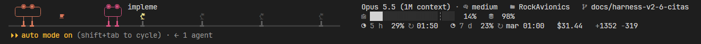

# StatusBarDFR

Una status line para [Claude Code](https://claude.com/claude-code) que convierte la barra de abajo en una
pequeña oficina: Clawd, la mascota de Claude, trabaja en su escritorio imitando lo que Claude está haciendo,
y cada subagente que lanza aparece como un amigo en su propio escritorio. A la derecha, un tablero con todo
lo que conviene tener a la vista: contexto, caché, límites de uso y costo.



Son tres líneas en color verdadero, dibujadas con iconos de Nerd Font y actualizadas una vez por segundo.

## Qué muestra

### La escena

**Clawd** cambia de pose según lo que Claude esté haciendo:

| Pose | Cuándo |
|---|---|
| Leyendo | `Read`, `Grep`, `Glob` |
| Escribiendo | `Edit`, `Write`, `NotebookEdit` |
| Ejecutando | `Bash`, `PowerShell` |
| Navegando | `WebFetch`, `WebSearch` y el navegador |
| Delegando | mientras espera a sus subagentes |
| Pensando | mientras prepara la respuesta |
| Esperando | cuando el turno es tuyo |
| Dormido | tras 5 minutos esperándote |
| Sobresalto | 3 segundos después de un error de herramienta |
| Compactando | cuando se compacta el contexto |

Además, la escena refleja cómo va la sesión:
- **Sudor** cuando el contexto pasa del 75 % (y más al 90 %).
- **Un café** tibio o frío según la caché de prompt esté viva o se haya enfriado.
- **Un reloj de arena** en amarillo o rojo cuando la ventana de 5 horas pasa del 85 % o del 95 %.

**Los amigos** son los subagentes en curso. Cada uno ocupa un escritorio con su lámpara, lleva el nombre de
su tipo y muestra en su tableta la herramienta que está usando. El color indica el tipo: azul para
`Explore`, verde para `general-purpose`, ámbar para `Plan` y rosa para los agentes propios. Cuando no hay
escritorios para todos, se muestra `+N`.

### El tablero

- Modelo y nivel de esfuerzo.
- Carpeta, rama (o worktree) y número de PR con su estado en color.
- Barra de contexto con una marca `┆` donde Claude Code autocompacta.
- Tasa de aciertos de la caché de prompt y cantidad de fallos.
- Uso de las ventanas de **5 horas** y **7 días**, con la hora a la que se reinicia cada una.
- Costo de la sesión en dólares y líneas agregadas y quitadas.

### Se adapta al ancho

A medida que la terminal se angosta, la barra se pliega por niveles: primero achica los escritorios, luego
deja menos amigos a la vista y al final muestra solo el tablero. El nivel depende del ancho de la terminal, no
del contenido, así que la barra no parpadea cuando cambia la rama o el costo.

## Requisitos

- **Claude Code**.
- **Python 3**, sin paquetes adicionales: el script usa solo la biblioteca estándar. Probado con Python 3.12.
- **Una [Nerd Font](https://www.nerdfonts.com/)** configurada en la terminal. Sin ella, los iconos salen como
  cuadritos. Se recomienda la variante *Mono* (por ejemplo `JetBrainsMono Nerd Font Mono`), que dibuja cada
  icono en una sola celda.
- **Una terminal con color verdadero** (24 bits).

Probado en Windows 11 con la terminal integrada de VS Code. En macOS, Linux y otras terminales debería
funcionar, pero todavía no está probado.

## Instalación

1. Clona el repositorio en cualquier carpeta:

   ```sh
   git clone https://github.com/dfrobledo/StatusBarDFR.git
   ```

2. Agrega esto a `~/.claude/settings.json` (en Windows, `%USERPROFILE%\.claude\settings.json`), con las
   rutas de tu Python y de tu copia del script:

   ```json
   "statusLine": {
     "type": "command",
     "command": "python /ruta/a/StatusBarDFR/statusline.py",
     "refreshInterval": 1,
     "padding": 0
   }
   ```

   En Windows conviene usar la ruta completa al intérprete y barras normales, por ejemplo
   `"\"C:/Program Files/Python312/python.exe\" C:/herramientas/StatusBarDFR/statusline.py"`.
   `refreshInterval: 1` es lo que anima la escena una vez por segundo.

3. Abre una sesión nueva de Claude Code. La barra aparece abajo del cuadro de texto.

### Configuración recomendada para VS Code

```json
"terminal.integrated.fontFamily": "JetBrainsMono Nerd Font Mono",
"terminal.integrated.minimumContrastRatio": 1,
"terminal.integrated.gpuAcceleration": "on"
```

Con `minimumContrastRatio: 1`, VS Code respeta los colores tal cual en lugar de ajustarlos.

## Probarla sin Claude Code

`tools/vista.py` imprime una galería con todas las poses, los amigos y cada nivel de plegado:

```sh
python tools/vista.py              # todo
python tools/vista.py --ancho 120  # la barra compuesta para 120 columnas
```

Sirve para comprobar que la fuente y los colores se ven bien antes de configurarla.

## Si algo falla

La barra nunca rompe la sesión: si los datos que manda Claude Code no se pueden leer, muestra solo el modelo
y la carpeta, y si el script falla del todo, muestra `Claude`.

## Tests

```sh
python -m pip install pytest
python -m pytest
```

## Licencia

[MIT](LICENSE).
